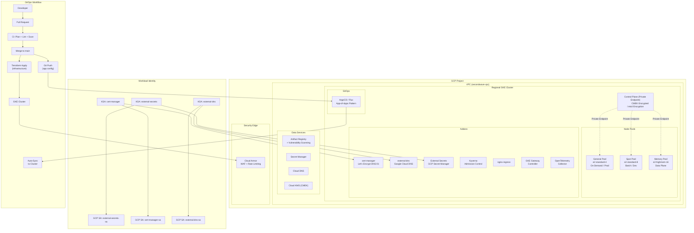
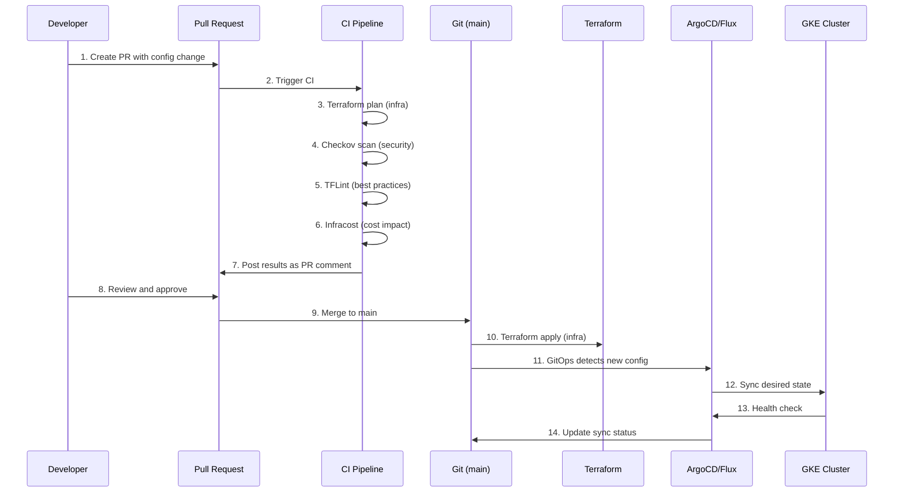

# SecondWave GCP Container Platform

**Enterprise-grade GKE + GitOps platform for fintech workloads**

---

## SecondWave Scenario

SecondWave is a London-based fintech startup processing £500M+ in monthly transaction volume. They need a PCI-DSS-compliant Kubernetes platform to run their microservices architecture. The platform team (3 people) must deliver:

- **RTO 4 hours** for the container platform (cluster recovery)
- **99.95% uptime SLA** for customer-facing APIs
- **PCI-DSS scope** for payment processing workloads
- **GitOps-driven** deployment model with full audit trail
- **Multi-environment** (dev, staging, prod) with progressive delivery
- **Zero-trust security** with keyless authentication

This repository provisions the entire platform foundation.

---

## Architecture



---

## Architecture Decisions

| Decision | Choice | Rationale |
|---|---|---|
| Cluster mode | **GKE Standard** | Node taints for PCI workload segregation, CMEK on control plane, spot VMs for cost |
| Cluster access | **Private endpoint** | No public API — all access via VPC peering/VPN |
| Node auth | **Workload Identity** | No static SA keys — keyless, short-lived tokens per pod |
| Policy engine | **Kyverno** | YAML-based policies (no Rego DSL), lower learning curve |
| Secret sync | **External Secrets** | Push-based sync for rotation, native K8s Secret objects |
| TLS certs | **cert-manager** | Let's Encrypt DNS-01 via Cloud DNS, auto-renewal |
| DNS sync | **external-dns** | Auto-creates DNS records from Ingress/Service resources |
| Ingress | **nginx-ingress + Gateway** | Dual: nginx for backward compat, Gateway for new workloads |
| GitOps | **ArgoCD / Flux (configurable)** | Declarative state, self-healing, audit trail |
| State storage | **GCS + CMEK** | Encrypted at rest, object versioning for recovery |
| IaC scanning | **Checkov + Trivy** | Security scanning in CI, shift-left approach |

---

## Production Safeguards

| Safeguard | Mechanism | SECURITY SAFEGUARD Callout |
|---|---|---|
| No public endpoint | `enable_private_endpoint = true` | Control plane is unreachable from the internet |
| Keyless pod auth | Workload Identity | No GCP SA keys in Secrets — zero static credentials |
| Admission control | Kyverno ClusterPolicies | Blocks privileged pods, enforces probes, read-only rootfs |
| Encrypted at rest | CMEK on etcd + boot disks | Google cannot decrypt cluster data without SecondWave's KMS key |
| Encrypted in transit | mTLS between nodes + ALTS | All inter-node traffic encrypted |
| Network isolation | Private cluster + Calico policy | Workloads cannot reach the public internet unless explicitly allowed |
| WAF protection | Cloud Armor OWASP rules | SQLi, XSS, LFI, RCE blocked at the edge before reaching GKE |
| Rate limiting | Cloud Armor throttle | 1000 req/IP/min — brute force protection |
| Supply chain | Binary Authorization (prod) | Only attested images can deploy |
| Vulnerability scanning | Artifact Registry + Trivy | Images scanned at rest and in CI |
| Drift detection | GitOps (ArgoCD/Flux) | Any manual change is detected and reverted |
| Deletion protection | `deletion_protection = true` | Cluster cannot be accidentally destroyed |
| Shielded VMs | Secure boot + vTPM + integrity monitoring | Rootkit/bootkit prevention |
| Minimal SA scopes | Per-node-pool SAs with narrow scopes | No `cloud-platform` scope on any node |
| Audit logging | Cloud Audit Logs + K8s audit | Every API call logged, immutable for PCI-DSS |

---

## Trade-offs and Alternatives

| Aspect | Our Choice | Alternative Considered | Why Not |
|---|---|---|---|
| Cluster mode | Standard | Autopilot | No taints, no CMEK on CP, no spot pricing |
| Ingress | nginx + Gateway | Only Gateway | Existing apps use Ingress v1 |
| Policy | Kyverno | OPA/Gatekeeper | Rego DSL learning curve for small team |
| Secret sync | ESO | CSI Driver | No env-var support in CSI, no push-sync |
| Monitoring | OTel + Cloud Monitoring | Prometheus/Grafana | GCP-native reduces operational overhead |
| CI/CD | GitHub Actions | GitLab CI, CircleCI | Team already uses GitHub |
| Testing | Terratest | kitchen-terraform | Go is team's primary language |
| Cost estimation | Infracost | Manual spreadsheets | Automated, PR-integrated cost awareness |

---

## GitOps Workflow



---

## Prerequisites

- **GCP Project** with billing enabled
- **gcloud CLI** (latest) — authenticated with sufficient permissions (Project Owner or roles listed below)
- **Terraform** v1.6+ — [install](https://developer.hashicorp.com/terraform/downloads)
- **kubectl** — for cluster access
- **helm** v3+ — for chart deployments
- **asdf** (recommended) — for tool version management

### Required GCP IAM Roles

| Role | Purpose |
|---|---|
| `roles/container.admin` | Create/manage GKE clusters |
| `roles/iam.serviceAccountAdmin` | Create service accounts |
| `roles/iam.serviceAccountUser` | Allow SAs to be used by GKE |
| `roles/secretmanager.admin` | Create/read secrets |
| `roles/cloudkms.admin` | Manage CMEK keys |
| `roles/dns.admin` | Manage Cloud DNS (external-dns) |
| `roles/compute.securityAdmin` | Cloud Armor policies |
| `roles/artifactregistry.admin` | Container registry |

---

## Deployment Instructions

### 1. Bootstrap Backend

```bash
# Create the GCS state bucket and KMS encryption key
./scripts/bootstrap-backend.sh <PROJECT_ID> <ENVIRONMENT>

# Example:
./scripts/bootstrap-backend.sh secondwave-platform-dev dev
```

### 2. Configure Variables

```bash
cp terraform.tfvars.example terraform.tfvars
# Edit terraform.tfvars with your project-specific values
```

### 3. Deploy

```bash
# Initialize Terraform (local mode first)
terraform init -backend=false

# Validate configuration
terraform validate

# Review execution plan
terraform plan -out=tfplan

# Deploy infrastructure
terraform apply tfplan

# Uncomment backend block in versions.tf and re-init for state management
# terraform init -migrate-state
```

### 4. Configure kubectl

```bash
gcloud container clusters get-credentials <CLUSTER_NAME> \
  --region <REGION> \
  --project <PROJECT_ID>
```

### 5. Verify Deployment

```bash
# Check cluster nodes
kubectl get nodes -o wide

# Check system pods
kubectl get pods -n kube-system

# Check addons
kubectl get pods -n cert-manager
kubectl get pods -n kyverno
kubectl get pods -n external-secrets
kubectl get pods -n ingress-nginx

# Check ArgoCD (if deployed)
kubectl get pods -n argocd
kubectl get applications -n argocd
```

---

## Module Structure

```
gcp/container-platform/
├── main.tf                          # Root module — composes all sub-modules
├── versions.tf                      # Provider constraints, GCS backend (commented)
├── variables.tf                     # All root-level variables
├── outputs.tf                       # Root outputs
├── terraform.tfvars.example         # Example variable values
│
├── modules/
│   ├── gke-cluster/                 # Private GKE cluster with CMEK
│   ├── gke-node-pools/             # Spot/reserved/node pools with taints
│   ├── gitops-bootstrap/           # ArgoCD or Flux bootstrap
│   ├── iam-workload-identity/      # KSA → GSA bindings
│   └── addons/                     # cert-manager, ESO, Kyverno, etc.
│
├── .github/workflows/
│   ├── gke-deploy.yml              # Terraform deploy via OIDC
│   └── argocd-bootstrap.yml        # GitOps config validation
│
├── docs/
│   ├── ADR/                        # Architecture Decision Records
│   └── runbooks/                   # Operational runbooks
│
├── observability/                  # OTel collector, Cloud Monitoring dashboard
├── tests/                          # Terratest infrastructure tests
├── scripts/                        # Bootstrap and utility scripts
└── config files                    # .tflint.hcl, .checkov.yml, .pre-commit-config.yaml, etc.
```

---

## Observability

### OpenTelemetry Collector

A DaemonSet-based OTel collector runs on every node, forwarding:
- **Metrics**: kubelet stats, host metrics, pod resource usage → Cloud Monitoring
- **Traces**: OTLP traces from instrumented workloads → Cloud Trace
- **Logs**: Structured logs from workloads → Cloud Logging

### Cloud Monitoring Dashboard

A custom dashboard (`observability/gke-dashboard.json`) with:
- Cluster CPU/memory utilisation (by node pool)
- Pod restart counts (last 24h)
- API server latency (p99)
- Node count by status
- Workload count by namespace
- Certificate expiry monitoring
- Error log rates
- Network bandwidth (in/out)

### Alerts (configured via Cloud Monitoring)

| Alert | Condition | Severity |
|---|---|---|
| `NodeNotReady` | Any node not ready >5m | P1 |
| `ClusterCPUHigh` | CPU >85% for 15m | P2 |
| `PodCrashLooping` | Pod restart >3 in 5m | P2 |
| `CertificateExpiring` | Cert expires in <14d | P2 |
| `ApiserverLatencyHigh` | p99 > 5s for 5m | P1 |
| `WorkloadIdentityFailure` | Token exchange fails | P1 |

---

## Disaster Recovery

### RTO: 4 hours | RPO: 1 hour

| Scenario | Recovery Strategy | Time |
|---|---|---|
| Control plane failure | GCP-managed — automatic recovery | < 30 min |
| CMEK key disabled | Re-enable key (Cloud KMS) | < 5 min |
| Accidental cluster deletion | Restore from Terraform state (GCS versioning) | < 2 hours |
| Regional outage | Deploy to secondary region (DR plan) | < 4 hours |
| Data corruption | Restore Velero backup | < 2 hours |

See [docs/runbooks/gke-cluster-recovery.md](docs/runbooks/gke-cluster-recovery.md) for detailed steps.

### Backup Strategy

- **Terraform state**: GCS bucket with object versioning (30-day retention)
- **Kubernetes resources**: Velero backups to GCS (cross-region)
- **Container images**: Artifact Registry with tag immutability (no deletion)
- **Secrets**: GCP Secret Manager (regional, with replication)

---

## Security Compliance

SecondWave's container platform is designed for the following compliance frameworks:

| Framework | Relevant Controls | Implementation |
|---|---|---|
| **PCI-DSS** | 1.2, 1.3, 2.2, 4.1, 7.1, 10.2, 10.5 | Private cluster, network policies, shielded VMs, audit logging, CMEK |
| **SOC 2** | CC6.1, CC6.6, CC7.1 | Workload Identity, GitOps audit trail, Binary Authorization |
| **ISO 27001** | A.12.6.1, A.13.1.1, A.18.1.4 | Vulnerability scanning, network segmentation, Cloud Armor |

---

## Testing

```bash
# Unit tests (Helm chart validation)
cd tests
go test -v -run TestHelmDeployment -timeout 30m

# Integration tests (requires GCP project)
export GCP_PROJECT_ID="secondwave-platform-dev"
go test -v -run TestGKECluster -timeout 60m
```

---

## Local Development

```bash
# Install tools via asdf
asdf install

# Install pre-commit hooks
pre-commit install

# Lint Terraform
tflint --config .tflint.hcl

# Security scan
checkov --config-file .checkov.yml

# Cost estimation
infracost breakdown --path .
```

---

## Repository Contents

| File | Purpose |
|---|---|
| `versions.tf` | Provider constraints, GCS backend config |
| `main.tf` | Root module — cluster, node pools, IAM, addons, GitOps |
| `variables.tf` | All configurable variables with descriptions |
| `outputs.tf` | Cluster endpoint, CA cert, WI pool, etc. |
| `.tflint.hcl` | Terraform linting rules |
| `.checkov.yml` | IaC security scanning config |
| `.pre-commit-config.yaml` | Git hooks for local validation |
| `.infracost.yml` | Cloud cost estimation |
| `.tool-versions` | asdf tool versions |
| `scripts/bootstrap-backend.sh` | GCS bucket + KMS key creation |
| `docs/ADR/*.md` | Architecture Decision Records |
| `docs/runbooks/*.md` | Operational runbooks |
| `observability/otel-collector.yaml` | OTel DaemonSet manifest |
| `observability/gke-dashboard.json` | Cloud Monitoring dashboard |
| `tests/*_test.go` | Terratest test suites |

---

## Related Repositories

- [secondwave/gitops-config](https://github.com/secondwave/gitops-config) — ArgoCD/Flux application configs
- [secondwave/gcp-networking](https://github.com/secondwave/gcp-networking) — VPC, subnets, firewall rules
- [secondwave/platform-policies](https://github.com/secondwave/platform-policies) — Kyverno policies repository

---

*Built for SecondWave Fintech — Platform Engineering Team*
